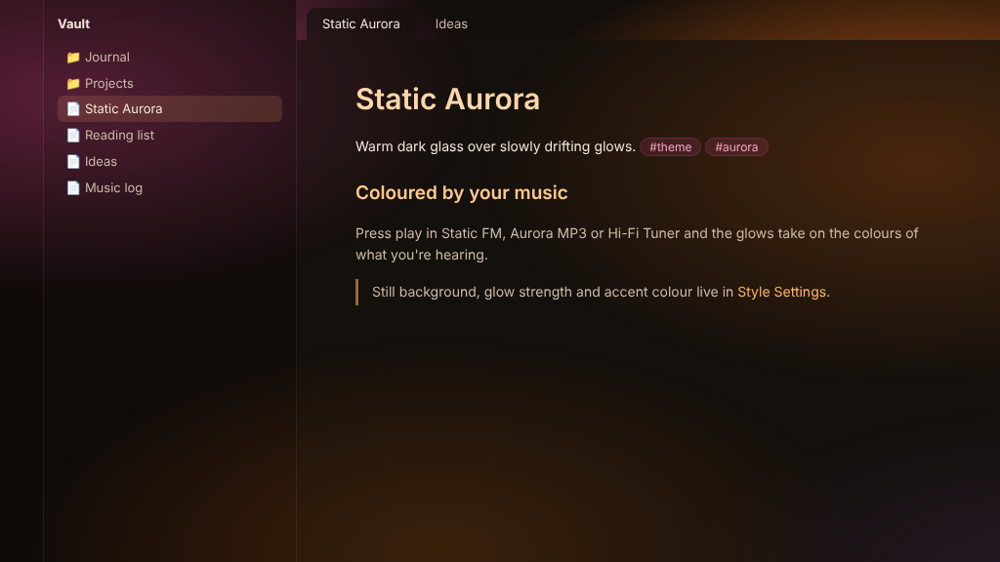

# Static Aurora

A warm, dark Obsidian theme with soft glows drifting behind frosted-glass panes, after the Aurora look of Static FM. Light mode is a Windows 2000 classic look.

## Coloured by your music

The glows can follow what you're listening to. Press play in one of these plugins and the theme fades to match:

- **Static FM:** the colours of your noise mix.
- **Aurora MP3:** the colours of the album cover.
- **Hi-Fi Tuner:** colours that suit the station's genre.

The colours change only when you press play, and stay when you pause. Each plugin has a setting to turn this off. With no player running, the theme uses its own rose and amber glows.

## Light mode: Windows 2000 classic

Silver 3D panels, Tahoma, white pages and navy-to-blue title bars. While a player is colouring the theme, the title bars take its colours instead.

## Settings

With the [Style Settings](https://github.com/mgmeyers/obsidian-style-settings) plugin installed:

- **Still background:** stop the glows drifting. There's also a command for it.
- **Glow strength:** from off to extra bright.
- **Accent colour:** amber, rose or sea.

The glows also stop drifting when your system asks for reduced motion.

## Install

**Settings → Appearance → Themes → Manage**, search for **Static Aurora**, then **Install and use**.

## Support

If you enjoy it, you can [buy me a coffee](https://buymeacoffee.com/ashotis). Questions or problems: open an issue, or email Hello@utilitiz.net.

## License

[MIT](LICENSE) © AshOtis
